<div align="center">

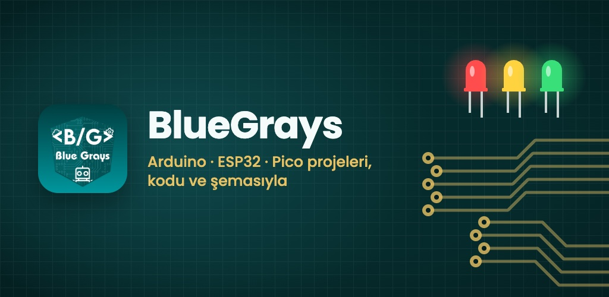

# Arduino Projeleri · Arduino Projects

**Arduino, ESP32 ve Raspberry Pi Pico projeleri: kaynak kodlar, devre şemaları ve adım adım anlatımlar.**
**Arduino, ESP32 and Raspberry Pi Pico projects: source code, circuit diagrams and step-by-step guides.**

[](https://bluegrays.com)
[](https://github.com/yemreeke/Arduino-Projeleri/stargazers)
[](https://github.com/yemreeke/Arduino-Projeleri/network/members)
[](LICENSE.md)
[](https://www.instagram.com/bluegraysapp/)
[](https://www.tiktok.com/@bluegraysapp)

[](https://apps.apple.com/tr/app/arduino-projects-bluegrays/id6502332602)
[](https://play.google.com/store/apps/details?id=com.bluegrays.ino)

**[bluegrays.com](https://bluegrays.com)** · Telefondan tek link / one link for your phone: **[bluegrays.app](https://bluegrays.app)**

</div>

---

## Uygulamadan kareler · Screenshots

<p align="center">
  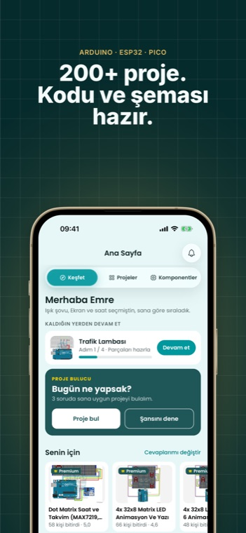
  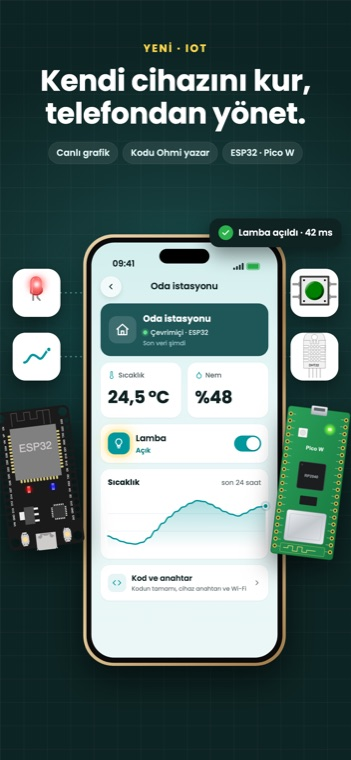
  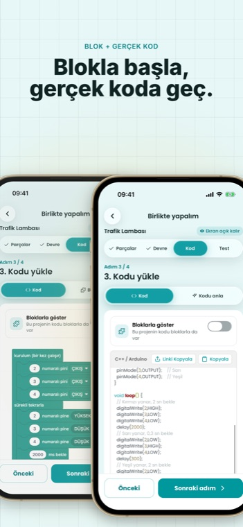
  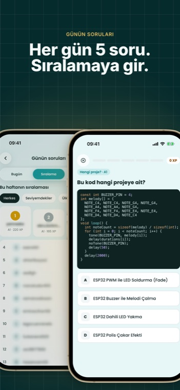
  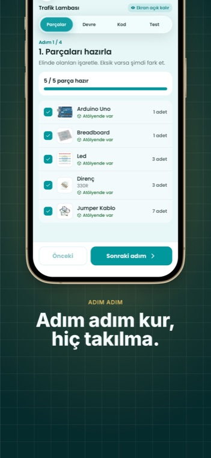
  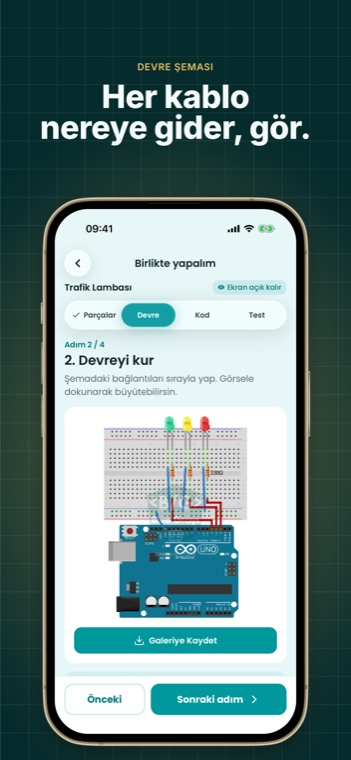
</p>

<details>
<summary><b>English screenshots</b></summary>
<br />
<p align="center">
  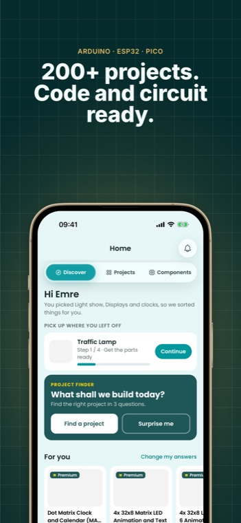
  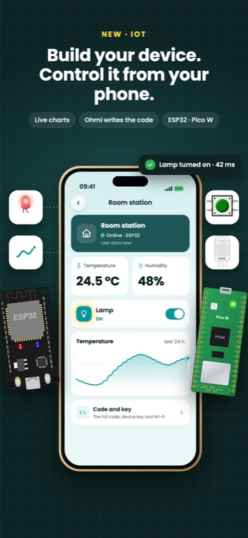
  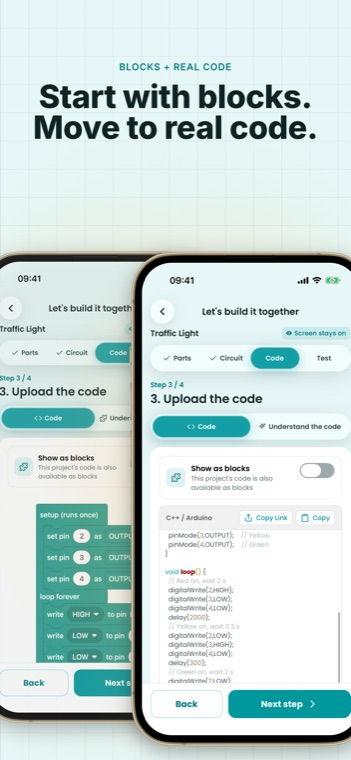
  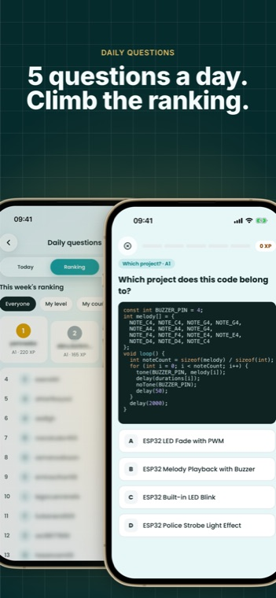
  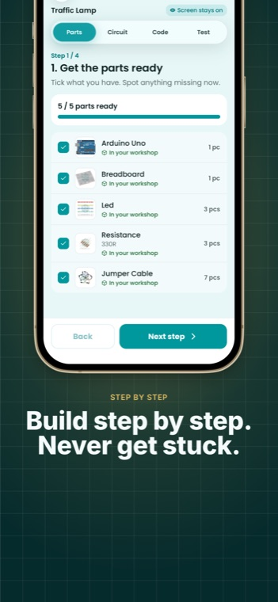
  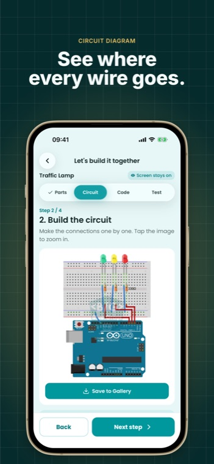
</p>
</details>

---

## Bu repo artık BlueGrays'in bir parçası · This repo is now part of BlueGrays

Bu repoda Instagram'da paylaştığım ilk 78 Arduino projesinin kodları duruyor. Projelerin güncel, çok daha geniş ve düzenli hâli artık **[BlueGrays](https://bluegrays.com)** uygulamasında ve web sitesinde. Orada Arduino'nun yanında **ESP32** ve **Raspberry Pi Pico** projeleri, devre şemaları, komponent listeleri, Wokwi simülasyon videoları, IoT paneli, günlük sorular ve ücretsiz elektronik hesaplama araçları da var.

This repo holds the code of the first 78 Arduino projects I shared on Instagram. The up-to-date, much larger and organized collection now lives in the **[BlueGrays](https://bluegrays.com)** app and website, which also covers **ESP32** and **Raspberry Pi Pico** projects, circuit diagrams, component lists, Wokwi simulation videos, an IoT dashboard, daily quizzes and free electronics calculators.

<div align="center">

| | |
|---|---|
| **220+** proje · projects | Arduino, ESP32, Raspberry Pi Pico |
| **130+** komponent · components | Pin şemaları, teknik bilgiler · pinouts and specs |
| **400+** soru · quiz questions | Her gün 5 soru, haftalık XP ligi · 5 a day, weekly XP league |
| **36** ders kartı · lessons | Arduino C++ ve MicroPython kod rehberi · code guide |
| **230+** blog yazısı · articles | Başlangıç rehberleri ve sorun çözümleri · guides and fixes |
| **10** dil · languages | TR, EN, DE, ES, FR, IT, PT, JA, ID, RU |

</div>

---

## Uygulamada neler var · What's in the app

| Türkçe | English |
|---|---|
| **Proje kütüphanesi:** Başlangıçtan ileri seviyeye Arduino, ESP32 ve Raspberry Pi Pico projeleri; kod, devre şeması, malzeme listesi ve sorun giderme | **Project library:** Arduino, ESP32 and Raspberry Pi Pico projects from beginner to advanced, with code, circuit diagram, parts list and troubleshooting |
| **Simülasyon videoları:** Projelerin çalışan hâli Wokwi simülasyonuyla, adım adım | **Simulation videos:** Every project shown working in a Wokwi simulation |
| **IoT paneli:** ESP32 ya da Pico W kartını Wi-Fi ile bağla; telefondan anahtar, kaydırıcı, renk seçici ve canlı grafiklerle yönet | **IoT dashboard:** Connect your ESP32 or Pico W over Wi-Fi and control it from your phone with switches, sliders, color pickers and live charts |
| **Günün soruları ve XP ligi:** Her gün 5 soru çöz, XP topla, haftalık sıralamada yüksel | **Daily questions and XP league:** Solve 5 questions a day, earn XP and climb the weekly ranking |
| **Kod rehberi:** Arduino C++ ve MicroPython'u kısa ders kartları ve mini testlerle öğren | **Code guide:** Learn Arduino C++ and MicroPython with short lesson cards and mini tests |
| **Blok kodlama:** Projenin kodunu bloklarla gör, sonra gerçek koda geç | **Block coding:** See a project's code as blocks, then move on to real code |
| **Komponent rehberi:** Sensörler, ekranlar, motorlar ve modüller; pin şemaları ve kullanım örnekleri | **Component guide:** Sensors, displays, motors and modules with pinouts and examples |
| **Elimdekilerle ne yaparım:** Atölyene parçalarını ekle, onlarla yapabileceğin projeleri gör | **What can I build:** Add the parts you own and see the projects you can make |
| **Elektronik araçları:** Direnç renk kodu, Ohm kanunu, LED direnci, gerilim bölücü, 555 zamanlayıcı, transistör bacakları ve daha fazlası | **Electronics tools:** Resistor color code, Ohm's law, LED resistor, voltage divider, 555 timer, transistor pinouts and more |
| **Pinout:** Arduino, ESP32 ve Raspberry Pi kartlarının etkileşimli pin şemaları | **Pinout:** Interactive pin maps for Arduino, ESP32 and Raspberry Pi boards |
| **Rozetler ve ilerleme:** Projeleri tamamladıkça rozet kazan | **Badges and progress:** Earn badges as you complete projects |
| **Ücretsiz başla:** Ücretsiz indir, Premium ile tüm projelerin kilidini aç | **Free to start:** Download for free, unlock every project with Premium |

<div align="center">

[](https://apps.apple.com/tr/app/arduino-projects-bluegrays/id6502332602)
&nbsp;&nbsp;
[](https://play.google.com/store/apps/details?id=com.bluegrays.ino)

</div>

---

## BlueGrays IoT kütüphanesi · BlueGrays IoT library

ESP32 ve Raspberry Pi Pico W kartlarını BlueGrays uygulamasından yönetmek için açık kaynak Arduino kütüphanemiz: telefondan lambayı aç, sıcaklığı canlı izle, LED şeridin rengini değiştir. Arduino IDE'de Kütüphane Yöneticisi'nde **BlueGraysIoT** olarak aranabilir.

Our open-source Arduino library for controlling ESP32 and Raspberry Pi Pico W boards from the BlueGrays app: switch a lamp from your phone, watch live sensor values, change your LED strip's color.

[](https://github.com/yemreeke/BlueGraysIoT)

## Ücretsiz elektronik araçları · Free electronics tools

Uygulama indirmeden tarayıcıda kullanabilirsin · Use them in your browser, no install needed:

- [Direnç renk kodu hesaplama](https://bluegrays.com/tr/araclar/direnc-renk-kodu) · [Resistor color code](https://bluegrays.com/en/tools/resistor-color-code)
- [SMD direnç kodu](https://bluegrays.com/tr/araclar/smd-direnc-kodu) · [SMD resistor code](https://bluegrays.com/en/tools/smd-resistor-code)
- [Seri paralel direnç hesaplama](https://bluegrays.com/tr/araclar/seri-paralel-direnc-hesaplama) · [Series parallel resistor calculator](https://bluegrays.com/en/tools/series-parallel-resistor-calculator)
- [Ohm kanunu hesaplama](https://bluegrays.com/tr/araclar/ohm-kanunu-hesaplama)
- [LED direnci hesaplama](https://bluegrays.com/tr/araclar/led-direnci-hesaplama)
- [Gerilim bölücü hesaplama](https://bluegrays.com/tr/araclar/gerilim-bolucu-hesaplama)
- [555 zamanlayıcı hesaplama](https://bluegrays.com/tr/araclar/555-zamanlayici-hesaplama)
- [Transistör bacak bağlantıları](https://bluegrays.com/tr/araclar/transistor-bacak-baglantilari)
- [Arduino, ESP32 ve Raspberry Pi pinout](https://bluegrays.com/tr/araclar/arduino-esp32-raspberry-pi-pinout)
- [Tüm araçlar](https://bluegrays.com/tr/araclar) · [All tools](https://bluegrays.com/en/tools)

**Blog:** Arduino, ESP32 ve Pico rehberleri, sensör anlatımları ve sık hataların çözümleri için [BlueGrays Blog](https://bluegrays.com/tr/blog) · [English blog](https://bluegrays.com/en/blog)

---

## Bu repodaki projeler · Projects in this repo

Her klasör tek bir projedir: `.ino` kodu, devre şeması ve görseller içerir. Aynı projelerin güncel anlatımları, malzeme listeleri ve videoları [BlueGrays](https://bluegrays.com) uygulamasında.

Each folder is a self-contained project with the `.ino` sketch, circuit diagram and images. Updated guides, parts lists and videos for the same projects are in the [BlueGrays](https://bluegrays.com) app.

| Kategori · Category | Projeler · Projects |
|---|---|
| **LED ve animasyonlar · LED and animations** | 001–008, 039–040, 069–076 |
| **Butonlar ve girişler · Buttons and inputs** | 009–010, 059–064 |
| **Ses ve müzik · Sound and music** | 013–015, 026 |
| **Sensörler · Sensors** (LDR, PIR, IR, alev, gaz, DHT11, NTC, TCRT5000) | 011–012, 016–018, 024–025, 050–055, 077–078 |
| **Mesafe ve park sensörü · Distance and parking** | 027–028, 031 |
| **LCD ekran · LCD displays** | 029–033, 044, 046, 056, 064 |
| **7 segment gösterge · 7-segment display** | 041–043, 047–049 |
| **220 V röle uygulamaları · 220 V relay projects** | 019–021 |
| **Güvenlik · Security** (lazer, RFID, reed) | 022–023, 037–038, 053–054 |
| **Kablosuz · Wireless** (Bluetooth, Arduino'dan Arduino'ya) | 034, 057–058 |
| **Motorlar · Motors** (servo, step) | 035–036, 060, 067–068 |
| **Saat · RTC clock** | 045–046, 048 |
| **Özel klavyeler · Custom keyboards** | 065–066 |

220 V ile çalışan projelerde dikkatli ol; şebeke gerilimi hayati tehlike taşır, bağlantıyı bilen birine yaptır.
Projects that switch 220 V mains are dangerous; have the mains wiring done by someone qualified.

---

## Nasıl kullanılır · How to use

```bash
# Klonla · Clone
git clone https://github.com/yemreeke/Arduino-Projeleri.git

# Projeye gir · Open a project
cd "Arduino-Projeleri/001 - Led Yakma"

# .ino dosyasını Arduino IDE'de aç, devreyi kur ve yükle
# Open the .ino file in Arduino IDE, build the circuit and upload
```

Devre kurulumu, malzeme listesi ve simülasyon videosu için projeyi [BlueGrays uygulamasında](https://bluegrays.com) aç.
For the wiring guide, parts list and simulation video, open the project in the [BlueGrays app](https://bluegrays.com).

---

## Bağlantılar · Links

<div align="center">

| Platform | Bağlantı · Link |
|---|---|
| Web sitesi · Website | **[bluegrays.com](https://bluegrays.com)** |
| Uygulamayı indir · Get the app | [bluegrays.app](https://bluegrays.app) |
| App Store | [Arduino Projects · BlueGrays](https://apps.apple.com/tr/app/arduino-projects-bluegrays/id6502332602) |
| Google Play | [com.bluegrays.ino](https://play.google.com/store/apps/details?id=com.bluegrays.ino) |
| YouTube | [Arduino Projeleri oynatma listesi · playlist](https://www.youtube.com/playlist?list=PL-k0V4q-STNq9xRPwyVdV3su5cynRb_XB) |
| Instagram | [@bluegraysapp](https://www.instagram.com/bluegraysapp/) |
| TikTok | [@bluegraysapp](https://www.tiktok.com/@bluegraysapp) |
| Forum | [bluegrays.com/forum](https://bluegrays.com/forum) |

</div>

---

## Yıldız geçmişi · Star history

[](https://star-history.com/#yemreeke/Arduino-Projeleri&Date)

---

## Lisans · License

Bu repo açık kaynaktır, ayrıntılar [LICENSE.md](LICENSE.md) dosyasında.
This repo is open source, see [LICENSE.md](LICENSE.md) for details.

---

<div align="center">

**Bu repo işine yaradıysa bir yıldız bırak · If this repo helped you, leave a star**

[@yemreeke](https://github.com/yemreeke) · [BlueGrays](https://bluegrays.com)

</div>
